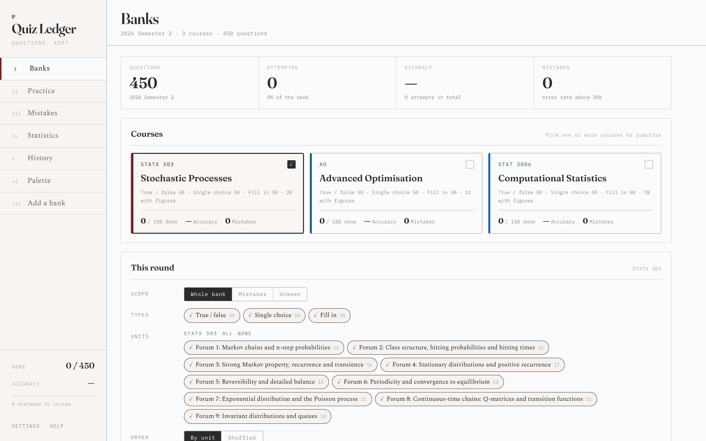

# Quiz Ledger

**English** · [简体中文](README.zh-CN.md)

A practice site for university course question banks. Formulas are typeset with KaTeX, and TikZ / pgfplots figures are compiled to SVG ahead of time. Banks are organised by semester and course: adding a course takes one JSON file and one catalog entry, and no course is named anywhere in the code.



The site currently holds three courses of 2026 Semester 2, 450 questions in total:

| Course | Bank file | Questions |
|---|---|---|
| STATX 303 Stochastic Processes | `banks/2026-s2/statx303.json` | 50 true/false, 50 single choice, 50 fill-in |
| Advanced Optimisation | `banks/2026-s2/advanced-optimisation.json` | 50 true/false, 50 single choice, 50 fill-in |
| STAT 3006 Computational Statistics | `banks/2026-s2/stat3006.json` | 50 true/false, 50 single choice, 50 fill-in |

## Features

**Choosing questions**
- Courses are listed by semester, and one round can draw on several courses at once.
- A round covers the whole bank, your mistakes, or questions you have not seen. Filter by question type, unit and difficulty, go through units in order or shuffle, and cap the round at 10, 20 or 50 questions.

**Answering**
- Four question types: true/false, single choice, multiple choice and fill-in.
- A tab per type shows its progress and remembers its position; the answer sheet jumps to any question.
- Submitting shows the result, the correct answer and the explanation at once. Fill-in answers are compared automatically first; when no match is found, the reference answer is shown and you mark yourself.
- Notes can be attached to a question once it is submitted.
- A round is saved after every step, so reloading or leaving the page keeps your place. Accuracy for the round is settled when you end it.
- Keyboard: `1`–`9` pick an option, `T` / `F` for true/false, `Enter` submits or moves on, `←` `→` change question.

**Records**
- Mistakes: questions with an error rate above 30%.
- Statistics per question: attempts, correct answers, accuracy, and how often each option was picked.
- History: the time, your answer and the result of every attempt.
- Daily accuracy, overall and per question type.
- Data stays in the browser and can be exported and imported as a JSON backup.

**Interface**
- 51 palettes (38 light, 13 dark); hover to preview, click to keep. Twenty-four are abstracted from rock album sleeves, from *Sgt. Pepper's* (1967) to *Kid A* (2000), and one from the film *Zima Blue*; hovering over a palette card names its source.
- English and Chinese. The first visit follows the browser language, and Settings switches it.

## Layout

```
index.html
css/            themes.css holds the palettes, app.css all other styles
js/
  i18n.js       interface strings
  tex.js        bank text to HTML (KaTeX plus a few text-mode commands)
  store.js      reading and writing attempt data; the storage backend is replaceable
  bank.js       loads the catalog and the banks
  quiz.js       builds rounds and grades answers
  views.js      the views
  app.js        routing, events, dialogs, keyboard
banks/
  catalog.json  semesters and courses
  2026-s2/      one bank per course; *.figures.json holds the compiled figures
templates/bank.template.json   bank template
schema/         JSON Schemas for banks and the catalog
tools/build.py  validates banks and compiles figures
docs/CONTRIBUTING.md           full guide to adding a bank (in Chinese)
vendor/katex/   KaTeX 0.16.11: stylesheet, fonts, and a copy of the script used when the CDN is unreachable
```

## Running locally

Browsers do not let a page opened from disk read the bank files, so start a local server:

```bash
python3 -m http.server 8000
# open http://localhost:8000
```

## Deploying

The project is static files with no build step. On GitHub, choose the branch and the root folder under Settings → Pages; any other static host works the same way.

## Adding a bank

1. Copy `templates/bank.template.json` to `banks/<semester>/<course>.json` and fill in the questions.
2. List the course in `banks/catalog.json`; a new semester is one more object in the `semesters` array.
3. Run `python3 tools/build.py` to validate the banks and compile the figures.

Question text is plain text with LaTeX: `$…$` for inline math and `$$…$$` for display math. A figure is a `tikzpicture` stored in the question's `figure.latex` field. The site's own **Add a bank** page lists every field in English, and [docs/CONTRIBUTING.md](docs/CONTRIBUTING.md) has the full reference in Chinese.

## Data storage

Attempt data is read and written through `QL.store.backend` in `js/store.js`. The default backend is the browser's localStorage, so the data lives on one device; export a backup from Settings before switching devices. To add accounts or cloud sync, provide an object with `get`, `set` and `remove` and assign it to `QL.store.backend`. Nothing else needs to change.

## Credits

- Layout, typography and the 25 light palettes follow [Stylish-Calendar](https://github.com/Hatsuyuki017/Stylish-Calendar) (Study Ledger); the palettes come from Thomas Shang's Tufte-Style Book Template.
- The bank structure and the practice flow follow [26-Xi-quizbank](https://github.com/Hatsuyuki017/26-Xi-quizbank).
- Formulas are typeset with [KaTeX](https://katex.org) (MIT License, see `vendor/katex/LICENSE`).

## License

The code is released under the MIT License; see [LICENSE](LICENSE).
