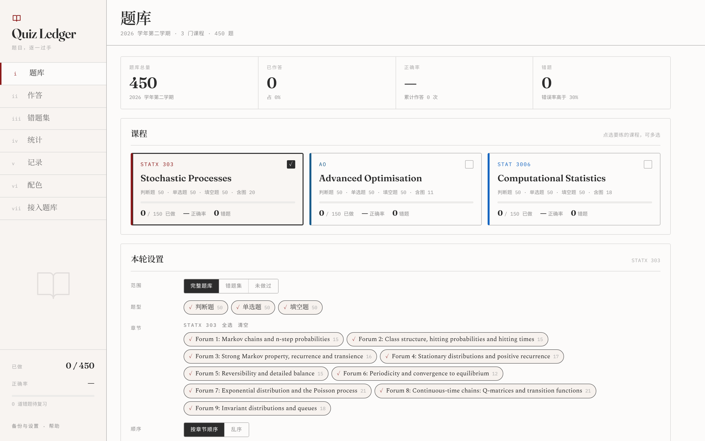

# Quiz Ledger

[English](README.md) · **简体中文**

多课程在线刷题平台。题目里的公式由 KaTeX 渲染，TikZ 与 pgfplots 图形预先编译成 SVG。题库按学期和课程组织，接入一门新课只需要一份 JSON 文件和一条目录记录，代码里没有写死任何课程。



目前收录 2026 Semester 2 的三门课，共 450 题：

| 课程 | 题库文件 | 题量 |
|---|---|---|
| STATX 303 Stochastic Processes | `banks/2026-s2/statx303.json` | 判断 50、单选 50、填空 50 |
| Advanced Optimisation | `banks/2026-s2/advanced-optimisation.json` | 判断 50、单选 50、填空 50 |
| STAT 3006 Computational Statistics | `banks/2026-s2/stat3006.json` | 判断 50、单选 50、填空 50 |

## 功能

**选题**
- 按学期列出课程，一轮作答可以同时选多门课。
- 范围可选完整题库、错题集、未做过的题；可按题型、章节、难度筛选，按章节顺序或乱序，题量可限定为 10、20、50 题。

**作答**
- 支持判断、单选、多选、填空四种题型。
- 题型选项卡显示各题型的进度并记住各自的位置；答题卡可以直接跳题。
- 提交后立即显示对错、正确答案和解析。填空题先自动比对，比对不上时显示参考答案，由作答者自己判定。
- 提交后可以给题目写笔记。
- 一轮作答的状态随时保存，刷新页面或切到别的页面再回来都能接着做；点结束作答后结算本轮正确率。
- 键盘：`1`–`9` 选选项，`T` / `F` 判断，`Enter` 提交或进入下一题，`←` `→` 翻题。

**记录**
- 错题集：错误率高于 30% 的题目。
- 逐题统计：作答次数、答对次数、正确率，点开可看各选项被选中的次数。
- 作答记录：每次作答的时间、所选答案和结果。
- 每日正确率趋势，总体和分题型各一张图。
- 数据保存在浏览器本地，可导出、导入 JSON 备份。

**界面**
- 51 套配色（38 套浅色，13 套深色），悬停预览，点选保存。其中 24 套取色自摇滚专辑封面，从 *Sgt. Pepper's*（1967）到 *Kid A*（2000），另有一套取自影片 *Zima Blue*；鼠标停在配色卡片上可以看到出处。
- 中文和英文两种界面语言。首次打开时跟随浏览器语言，可在备份与设置里切换。

## 目录结构

```
index.html
css/            themes.css 为配色，app.css 为全部样式
js/
  i18n.js       界面文字
  tex.js        把题库文本转成 HTML（KaTeX 加少量文本命令）
  store.js      作答数据的读写，存储后端可替换
  bank.js       读取目录和题库
  quiz.js       组卷与判分
  views.js      各个页面
  app.js        路由、事件、对话框、键盘
banks/
  catalog.json  学期与课程目录
  2026-s2/      各课程题库，*.figures.json 为编译好的图形
templates/bank.template.json   题库模版
schema/         题库与目录的 JSON Schema
tools/build.py  校验题库并编译图形
docs/CONTRIBUTING.md           接入题库的完整说明
vendor/katex/   KaTeX 0.16.11 的样式和字体，以及 CDN 无法访问时使用的脚本副本
```

## 本地运行

浏览器不允许直接双击打开的页面读取题库文件，需要起一个本地服务器：

```bash
python3 -m http.server 8000
# 打开 http://localhost:8000
```

## 部署

整个项目是静态文件，没有构建步骤。推到 GitHub 后在仓库的 Settings → Pages 里选择分支和根目录即可，其他静态托管同理。

## 接入新题库

1. 复制 `templates/bank.template.json` 到 `banks/<学期>/<课程>.json` 并填写题目。
2. 在 `banks/catalog.json` 里登记这门课；新学期就在 `semesters` 数组里加一个对象。
3. 运行 `python3 tools/build.py`，校验题库并编译图形。

字段说明、文本约定和图形的写法见 [docs/CONTRIBUTING.md](docs/CONTRIBUTING.md)。

## 数据存储

作答数据经由 `js/store.js` 里的 `QL.store.backend` 读写。默认后端是浏览器的 localStorage，数据只在当前设备上，换设备前请在备份与设置里导出。要接入账号或云端同步，实现一个带 `get`、`set`、`remove` 三个方法的对象并替换 `QL.store.backend` 即可，其余代码不用动。

## 来源

- 界面的版式、字体和 25 套浅色配色沿用 [Stylish-Calendar](https://github.com/Hatsuyuki017/Stylish-Calendar)（Study Ledger），配色出自 Thomas Shang 的 Tufte-Style Book Template。
- 题库结构和做题流程参考 [26-Xi-quizbank](https://github.com/Hatsuyuki017/26-Xi-quizbank)。
- 公式渲染使用 [KaTeX](https://katex.org)（MIT License，见 `vendor/katex/LICENSE`）。

## 许可

代码以 MIT License 发布，见 [LICENSE](LICENSE)。
